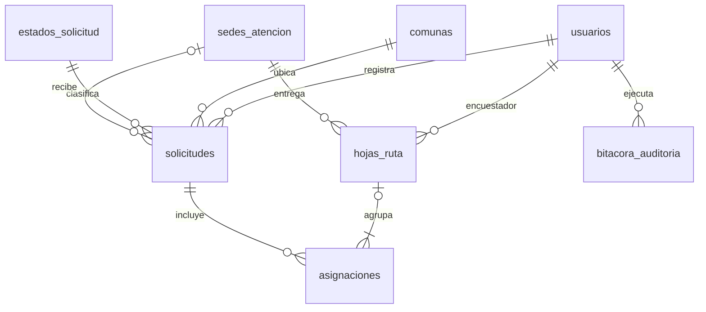

> Actualización final: `INFORME_FINAL.md`, `data/territorio/README.md` y `evidencias/README.md` describen el catálogo oficial, la configuración de sedes y la evidencia vigente. Este documento conserva el detalle de la implementación previa.

# Entrega 2: sedes, hojas de ruta e informes

Fecha de implementación: 16 de noviembre de 2026.

## Alcance y decisiones

Se implementan los requisitos 5–9 del enunciado y se corrigen aspectos de la entrega 1.
La enumeración explícita de ocho sedes prevalece como criterio de implementación frente
al contexto que menciona cinco puntos. Las coordenadas heredadas siguen siendo datos
de demostración y requieren validación de la entidad. La hoja contiene 20 solicitudes;
la fecha de inicio no convierte esa carga en una meta diaria de 20 visitas.

El sistema no realiza optimización matemática de rutas ni determina la elegibilidad de
ciudadanos para préstamos. El diligenciamiento y revisión digital de la encuesta completa
quedan fuera de estos nueve puntos.

## Historias de usuario y criterios verificables

| HU | Historia | Criterios de aceptación |
|---|---|---|
| HU-06 | Como ventanilla quiero ver las sedes y registrar dónde recibo la solicitud. | Ocho puntos fijos en el mapa; selección obligatoria de sede activa; sede persistida; registros previos sin sede se conservan sin atribución inventada. |
| HU-07 | Como enrutador quiero generar una carga de 20 solicitudes para un encuestador. | Exactamente 20 distintas; ubicación completa; pendientes sin asignar; encuestador activo; sede activa; inicio desde mañana; una ruta por encuestador y fecha; asignaciones y auditoría atómicas. |
| HU-08 | Como ventanilla quiero registrar la entrega de la hoja en el punto acordado. | Sede de entrega coincidente; mañana del día programado; una sola entrega; usuario y hora persistidos y auditados. |
| HU-09 | Como encuestador quiero consultar mi carga y descargarla. | Solo rutas propias; detalle con datos de contacto, sector y coordenadas; PDF con campos de control y orden de solicitudes. |
| HU-10 | Como administrador quiero exportar un informe de gestión. | Descarga PDF real; indicadores actuales; distribución por estado y sede; acceso exclusivo del administrador. |
| HU-11 | Como administrador, calidad o enrutador quiero analizar la operación. | Totales reales; radicadas hoy; vencidas sin cierre; próximas a vencer en tres días; estados, sedes y entregas. |

Requisitos no funcionales: autorización de cada endpoint en PHP, escape de datos en HTML,
consultas preparadas, transacciones y bloqueos frente a asignación simultánea, zona horaria
de Colombia en PHP y MySQL, diseño adaptable y mensajes de error recuperables.
La interfaz depende de los CDN y de la cartografía externa; no ofrece trabajo sin conexión.

## Modelo de datos actualizado



- `hojas_ruta`: encuestador, sede, fecha de inicio, creador, receptor de la entrega y hora.
  Restricción única `(id_encuestador, fecha_visita)`.
- `solicitudes.id_sede`: FK nullable para conservar registros anteriores sin sede conocida.
  Las nuevas solicitudes requieren una sede activa.
- `asignaciones.id_ruta` y `orden`: vinculan cada solicitud a una hoja conservando los datos
  anteriores. Las asignaciones históricas sin hoja se mantienen intactas.
- `consecutivos_solicitud`: contador diario bloqueado durante la transacción de registro.
  Se inicializa a partir de los consecutivos históricos del día al primer uso.
- Auditoría de creación y entrega dentro de la misma transacción del cambio.

La migración `scripts/migrate_entrega2.php` es aditiva e idempotente. MySQL hace commit
implícito de DDL: no se presenta la migración como una operación íntegramente reversible.

## Arquitectura y APIs

Se conserva `public/index.php` como único punto de entrada. `OperationController` valida
sesión, rol e identificadores; `OperationModel` concentra consultas y transacciones.
`PdfReport` produce PDF multipágina con bloques de cada visita juntos y texto WinAnsi.
La interfaz compartida `operations.js` se inicializa después de verificar la sesión.

Todas estas rutas tienen prefijo `api/operacion/`:

| Ruta | Método | Roles |
|---|---|---|
| catalogos | GET | Todos los perfiles autenticados; encuestadores visibles solo a administrador/enrutador |
| pendientes | GET | Administrador, enrutador |
| rutas | GET | Administrador, ventanilla, enrutador, encuestador; este último solo sus rutas |
| crear-ruta | POST | Administrador, enrutador |
| entregar-ruta | POST | Administrador, ventanilla |
| dashboard | GET | Administrador, calidad, enrutador |
| reporte | GET | Administrador |
| ruta-pdf | GET | Administrador, ventanilla, enrutador, encuestador; este último solo sus rutas |

## Correcciones de la entrega 1

- Filtro de estados usa IDs del catálogo en lugar de nombres enviados a una API numérica.
- Datos personales de la bitácora escapados al construir HTML.
- Registro de solicitud, ubicación y auditoría en una transacción; se retira la segunda
  petición de georreferenciación al crear desde ventanilla.
- Contador diario con bloqueo de fila, conservando el formato SOL-YYYYMMDD-####.
- Selección de sector validada como ID; corregimiento derivado del catálogo rural;
  no se permite mezclar comuna urbana con corregimiento.
- Límites de longitud y rangos de coordenadas en servidor.
- Cambio de ubicación restringido a solicitudes aún sin asignar.
- Consulta diaria por intervalo de fechas y zona horaria explícita de Colombia.
- Bloqueo HTTP de scripts, pruebas, documentación y archivos de configuración en XAMPP.

Actualización: se incorporó un catálogo oficial de 340 barrios/sectores, 22 comunas y
15 corregimientos. Las sedes de los seeders se sustituyeron por referencias explícitas
de los mapas, conservando sus valores anteriores y las sedes ya configuradas.

## Verificación y evidencias

Comandos reproducibles:

```text
php tests/role_access.php
node tests/role_frontend.mjs
php tests/api_access.php
php tests/integration.php
```

La integración utiliza una base efímera con nombre aleatorio y la elimina en `finally`.
Cubre registro con coordenadas, sede inválida, coordenadas incompletas, generación
concurrente de consecutivos, carga exacta, repetidos, fecha mínima, rol del encuestador,
asignación atómica, consulta de ruta ajena, doble asignación, entrega anticipada,
sede incorrecta, entrega duplicada, restricción horaria, dashboard y PDF paginado.
La regla horaria se prueba con un reloj inyectado en el modelo: se comprueba el rechazo
por la tarde, el éxito por la mañana y el bloqueo de una entrega repetida.

No se incluyen actas Scrum, capturas Jira, commits o ejecuciones CI ficticias.

## DevOps y documentación del equipo

Se agregan `docker/Dockerfile`, configuración Apache con raíz pública, `compose.yaml`,
`.dockerignore` y `.github/workflows/ci.yml`. El pipeline levanta el entorno, verifica
sintaxis, permisos, integración, frontend y acceso HTTP. Debe ejecutarse en el repositorio
GitHub real para producir evidencia verificable. Docker se valida por separado del
entorno XAMPP y conserva sus datos en un volumen propio.

Backlog para el equipo: registrar estas HU en Jira, definir responsables y capacidad,
registrar planificación y Daily Scrum reales, adjuntar revisión de resultados y
retrospectiva, enlazar PR/commits y runs CI, y completar la URL de despliegue y autores.
La documentación metodológica de entrega 1 es histórica: sus muestras de bitácoras no
sustituyen evidencias reales y las rutas antiguas deben actualizarse con esta arquitectura.


## Resultado de la verificación local

Verificado el 16 de noviembre de 2026 en XAMPP (PHP/MariaDB) y en Docker (PHP 8.2/MySQL 8.0):

- 46 pruebas de acceso a vistas/sesión correctas.
- 48 combinaciones de permisos API, respuestas JSON y PDF correctas.
- Integración completa correcta, incluidos tres registros concurrentes y entrega con reloj de prueba.
- Pruebas JavaScript existentes y sintaxis PHP/JavaScript correctas.
- Migración repetida sin pérdida de registros anteriores.
- Login HTTP 200; scripts, pruebas, configuración y documentos privados HTTP 403 en XAMPP.
- Paneles de administrador y ventanilla observados en navegador con los datos existentes.
- Hoja PDF de tres páginas renderizada; visitas completas conservadas en cada página.
- Imagen Docker construida y aplicación iniciada. Puerto local 18080, porque Windows
  bloqueó el puerto 8080. Docker usa una base separada de la instalación XAMPP.

El pipeline quedó preparado; aún no se ejecutó en GitHub. Las pruebas locales no son
una evidencia de que exista un run remoto de GitHub Actions.
